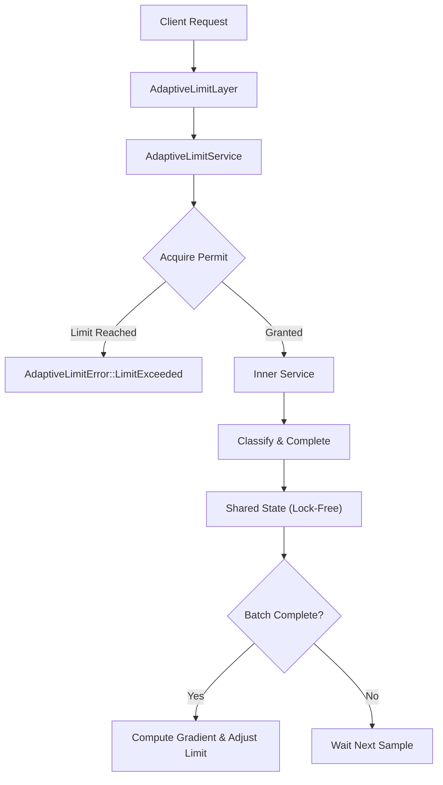

# Tower Ten

Adaptive concurrency limiter middleware for [Tower](https://github.com/tower-rs/tower) written in Rust. It dynamically adjusts in-flight request limits based on latency gradients and error feedback to protect services from overload without manual tuning.

> Inspired by TCP Vegas and Netflix Concurrency Limits, Tower Ten continuously samples request round-trip times (RTT) and balances throughput against latency degradation.

## Features

- Adaptive concurrency limiting using a Vegas-style latency gradient algorithm
- Lock-free, non-blocking state tracking using atomic primitives (`AtomicUsize`, `AtomicU64`)
- Exponentially weighted moving average (EWMA) for smooth RTT tracking
- Additive headroom exploration to discover available service capacity
- Multiplicative backoff on error spikes and drop penalties for cancelled requests
- RAII-based `Permit` guard ensuring accurate metrics even on future drop or panic
- Native integration with Tower `Service` and `Layer` abstractions
- Optional HTTP support for classifying 5xx server responses as failures
- Comprehensive runtime observability snapshot (`AdaptiveLimitSnapshot`)

## Architecture



The codebase is organized into modular components:

| Module | Responsibility |
|---|---|
| [`config`](src/config.rs) | Configuration options, builder pattern, and invariant validation |
| [`state`](src/state.rs) | Core adaptive limiter state, atomic counters, and Vegas adaptation logic |
| [`permit`](src/permit.rs) | RAII permit guard tracking active requests, elapsed duration, and drops |
| [`layer`](src/layer.rs) | Tower `Layer` implementation for middleware composition |
| [`service`](src/service.rs) | Tower `Service` wrapping inner services and managing futures |
| [`error`](src/error.rs) | Error type differentiating capacity exhaustion from inner service failures |
| [`http_support`](src/http_support.rs) | Optional HTTP helper to classify server error status codes (5xx) |

## How it works

Tower Ten computes a concurrency limit dynamically using an RTT gradient:

1. **Baseline Tracking**: Maintains the minimum observed RTT (`min_rtt`) over a rolling window (`min_rtt_window`).
2. **Smoothed Latency**: Computes an exponentially weighted moving average (`ewma_rtt`) across completed batches.
3. **Gradient Calculation**:
   ```text
   gradient = clamp(min_rtt / ewma_rtt, 0.0, 1.0)
   ```
4. **Limit Adjustment**:
   ```text
   new_limit = limit * gradient + headroom
   ```
   - When latency stays low (`gradient ≈ 1.0`), the limit grows by `headroom` up to `max_rampup_fraction`.
   - When latency climbs (`gradient < 1.0`), the limit contracts proportionally.
   - If errors occur during the epoch, a multiplicative penalty (`error_decrease_factor`) is applied.
   - If requests were dropped or cancelled, limit increases are suppressed.
   - The result is clamped to `[min_limit, max_limit]`.

## Tech stack

- Rust 2024 edition (MSRV 1.98)
- Tower (`tower::Service`, `tower::Layer`)
- Tokio and Futures (asynchronous execution and tests)
- `pin-project-lite` (safe projection for response futures)
- Optional `http` crate support

## Usage

Add `tower-ten` to your `Cargo.toml`:

```toml
[dependencies]
tower-ten = "0.1.0"
tower = "0.5"
```

To enable HTTP 5xx classification helpers:

```toml
[dependencies]
tower-ten = { version = "0.1.0", features = ["http"] }
```

### Basic Tower service example

```rust
use std::time::Duration;
use tower::{Service, ServiceBuilder};
use tower_ten::{
    config::AdaptiveLimitConfig,
    layer::AdaptiveLimitLayer,
    state::AdaptiveLimit,
};

#[tokio::main]
async fn main() -> Result<(), Box<dyn std::error::Error>> {
    let config = AdaptiveLimitConfig::new()
        .with_min_limit(2)
        .with_max_limit(256)
        .with_initial_limit(16)
        .with_headroom(4)
        .with_min_rtt_window(Duration::from_secs(60));

    let limiter = AdaptiveLimit::new(config)?;

    let layer = AdaptiveLimitLayer::new(limiter.clone())
        .with_classifier(|response: &String| !response.is_empty());

    // Build your wrapped service stack
    // let service = ServiceBuilder::new().layer(layer).service(my_inner_service);

    println!("Current limit: {}", limiter.current_limit());
    Ok(())
}
```

### Axum / HTTP classification example

With the `http` feature enabled, you can classify HTTP 5xx responses as failures:

```rust
use tower_ten::{
    config::AdaptiveLimitConfig,
    http_support::classify_http_5xx,
    layer::AdaptiveLimitLayer,
    state::AdaptiveLimit,
};

let limiter = AdaptiveLimit::new(AdaptiveLimitConfig::default())?;
let layer = AdaptiveLimitLayer::new(limiter).with_classifier(classify_http_5xx);
```

## Configuration

`AdaptiveLimitConfig` provides builder methods to tune the limiter behavior:

| Parameter | Default | Description |
|---|---|---|
| `min_limit` | `2` | Lower bound for concurrency limit |
| `max_limit` | `1024` | Upper bound ceiling for concurrency limit |
| `initial_limit` | `16` | Starting limit on initialization |
| `headroom` | `4` | Additive capacity added to the gradient to probe for bandwidth |
| `min_rtt_window` | `10m` | Sliding window duration to reset and measure minimum baseline RTT |
| `ewma_alpha` | `0.2` | Smoothing factor α for RTT EWMA (0 < α <= 1.0) |
| `adapt_batch_size` | `32` | Number of completed or dropped requests before adjusting the limit |
| `max_rampup_fraction` | `0.25` | Maximum percentage increase allowed in a single adaptation step |
| `error_decrease_factor` | `0.8` | Multiplier applied to shrink the limit when errors occur (0 < factor < 1.0) |

## Run checks locally

```bash
cargo fmt --all -- --check
cargo clippy --all-features --all-targets -- -D warnings
cargo test --all-features
```

## License

This project is licensed under the MIT License. See [`LICENSE`](LICENSE).
